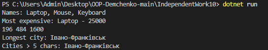

### Самостійна робота №10 (`IndependentWork10/README.md`)

# Самостійна робота №10: Делегати, вбудовані функціональні типи та лямбда-вирази

## Мета роботи
Опанувати роботу зі стандартними узагальненими делегатами (`Func<>`, `Action<>`, `Predicate<>`) та лямбда-виразами для написання власних утиліт обробки колекцій у функціональному стилі.

## Реалізація
Створено статичний клас `CollectionUtils`, який містить узагальнені методи вищого порядку:
* **`Map<TSource, TResult>`** — перетворює кожен елемент колекції за допомогою делегата `Func<TSource, TResult>`.
* **`MaxBy<T, TKey>`** — знаходить елемент із максимальним значенням ключа, визначеного через `Func<T, TKey>` (із обмеженням `IComparable<TKey>`).
* **`Filter<T>`** — виконує фільтрацію послідовності на основі умови `Predicate<T>`.
* **`ForEach<T>`** — застосовує дію `Action<T>` до кожного елемента колекції.

Роботу методів продемонстровано на колекціях товарів (`Product`), числових послідовностях та рядках.

## Запуск проєкту

