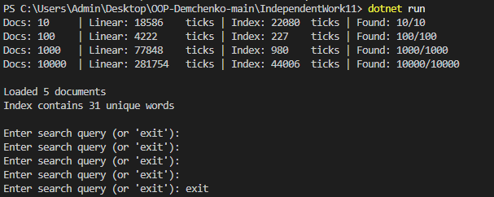

### Самостійна робота №11 (`IndependentWork11/README.md`)

# Самостійна робота №11: Інвертований пошуковий індекс та бенчмаркінг

## Мета роботи
Реалізувати повноцінний інвертований пошуковий індекс із попередньою обробкою тексту (токенізацією та фільтрацією стоп-слів) і порівняти його швидкодію з лінійним пошуком.

## Реалізація
* **`TextProcessor`** — розбиває текст на токени за допомогою регулярних виразів (`Regex`) та відсіює службові стоп-слова (`a`, `the`, `is`, `in`, `and` тощо) через `HashSet<string>`.
* **`InvertedIndex`** — будує відображення «слово $\rightarrow$ множина ID документів» (`Dictionary<string, HashSet<int>>`) та підтримує:
  * `SearchSingleWord` — пошук за одним термом;
  * `SearchMultipleWords` — логічне **AND** через перетин множин (`IntersectWith`);
  * `SearchAnyWord` — логічне **OR** через об'єднання множин (`UnionWith`).
* **`PerformanceTest`** — замірює час пошуку (у тіках `Stopwatch`) на обсягах від $10$ до $10\,000$ документів.

## Висновки щодо продуктивності
Лінійний пошук має складність $O(N \cdot M)$ (де $N$ — кількість документів, $M$ — середня кількість слів), тому час його роботи зростає пропорційно обсягу бази. Інвертований індекс забезпечує доступ за $O(1)$ до списку релевантних ID, даючи прискорення на кілька порядків на великих вибірках.

## Запуск проєкту

