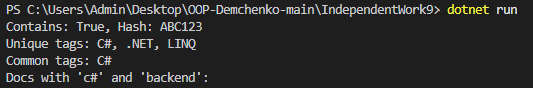

### Самостійна робота №12 (`IndependentWork12/README.md`)

# Самостійна робота №12: Побудова ETL-конвеєрів та аналітика даних за допомогою LINQ

## Мета роботи
Навчитися будувати декларативні конвеєри обробки та агрегації реляційних даних у пам'яті засобами LINQ (`Join`, `GroupBy`, `Select`, `OrderByDescending`, `ToDictionary`).

## Реалізація
На базі згенерованих моделей `Product`, `Customer` та `Sale` (500 транзакцій) реалізовано 4 аналітичні конвеєри із заміром часу виконання (`Stopwatch`):
1. **Топ-3 найпопулярніші товари в кожній категорії** — групування продажів за товаром, об'єднання з довідником товарів і вибірка лідерів за кількістю проданих одиниць.
2. **Загальний дохід по містах** — подвійний `Join` продажів із товарами та клієнтами з підрахунком сумарної виручки.
3. **Динаміка продажів по роках і місяцях** — групування за складеним ключем `{ Year, Month }` з агрегацією обсягів та виручки.
4. **Топ-5 клієнтів у категорії «Електроніка»** — попередня індексація товарів категорії у `Dictionary` для швидкої фільтрації за $O(1)$ та ранжування покупців за сумою витрат.

## Запуск проєкту

