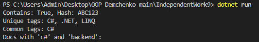

### Самостійна робота №13 (`IndependentWork13/README.md`)

# Самостійна робота №13: Паралельна обробка даних за допомогою PLINQ та потокобезпека

## Мета роботи
Дослідити ефективність паралельних запитів PLINQ (`AsParallel()`) на CPU-інтенсивних та тривіальних операціях, а також продемонструвати ризики стану гонитви (Race Condition) при використанні побічних ефектів.

## Реалізація
* **Бенчмарк `LINQ` vs `PLINQ`**:
  * На масивах від $1\,000\,000$ до $10\,000\,000$ елементів із важкими математичними обчисленнями (`HeavyMath`) PLINQ розподіляє навантаження між ядрами процесора, забезпечуючи кратне прискорення.
  * На невеликих колекціях із дешевими операціями (`x => x + 1`) послідовний LINQ працює швидше через накладні витрати на створення потоків, партиціонування та синхронізацію в PLINQ.
* **Демонстрація побічних ефектів та потокобезпеки**:
  * Інкремент звичайної змінної `unsafeCounter++` усередині `AsParallel()` призводить до втрати частини оновлень через неатомарність операції.
  * Проблему усунено за допомогою критичної секції `lock` та потокобезпечної колекції `ConcurrentBag<T>`.

## Запуск проєкту (рекомендовано в режимі Release)

