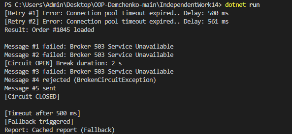

### Самостійна робота №14 (`IndependentWork14/README.md`)

# Самостійна робота №14: Патерни відмовостійкості з бібліотекою Polly

## Мета роботи
Опанувати сучасний підхід до побудови стійких розподілених застосунків у .NET за допомогою бібліотеки **Polly v8** (`ResiliencePipelineBuilder`).

## Реалізація
Реалізовано три практичні сценарії обробки тимчасових та критичних збоїв:
1. **Retry з експоненційною затримкою та Jitter** (`RunDatabaseRetryScenario`) — імітація відновлення підключення до БД після `TimeoutException` із випадковим розкидом затримок (`UseJitter = true`) для запобігання піковим навантаженням.
2. **Circuit Breaker** (`RunPaymentGatewayCircuitBreakerScenario`) — розмикання ланцюга при перевищенні порогу помилок `HttpRequestException` (`FailureRatio = 0.5`), миттєве відхилення запитів (`BrokenCircuitException`) під час паузи та автоматичне відновлення роботи сервісу.
3. **Timeout + Fallback** (`RunReportGenerationTimeoutFallbackScenario`) — обмеження часу генерації звіту до $500\text{ мс}$ із перехопленням `TimeoutRejectedException` і поверненням резервної кешованої версії звіту.

## Запуск проєкту

