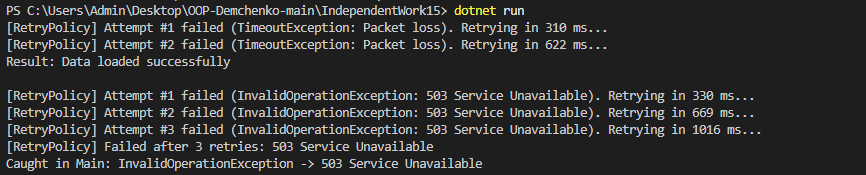

### Самостійна робота №15 (`IndependentWork15/README.md`)

# Самостійна робота №15: Власна реалізація політики повторних спроб (Exponential Backoff + Jitter)

## Мета роботи
Закріпити принципи проєктування механізмів відмовостійкості шляхом створення власного класу `RetryPolicy` без використання сторонніх бібліотек.

## Реалізація
* **`RetryPolicy`** — узагальнений виконавець операцій (`Execute<T>`), який підтримує:
  * обмеження максимальної кількості повторів (`maxRetries`);
  * **експоненційне зростання затримки** за формулою $t = t_0 \cdot 2^{\text{attempt}}$;
  * **випадковий Jitter** ($\pm\text{jitterFactor}$) для десинхронізації повторних запитів;
  * **фільтрацію винятків** через предикат `Func<Exception, bool>? shouldRetry`, що дозволяє повторювати лише тимчасові збої (наприклад, `TimeoutException`) і миттєво прокидати критичні помилки (`InvalidOperationException`).

## Запуск проєкту

