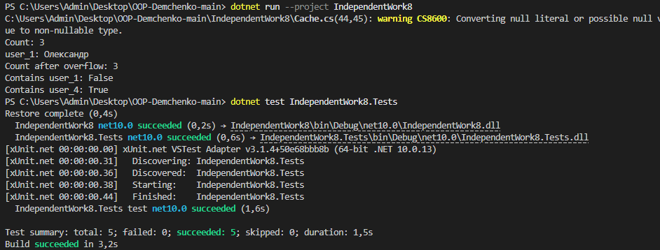

# Самостійна робота №8: Узагальнені колекції та юніт-тестування (FIFO Кеш)

## Мета роботи
Закріпити навички роботи з узагальненими (generic) типами у C#, поєднати структури даних `Dictionary<TKey, TValue>` та `Queue<T>` для побудови ефективного кешу з обмеженою місткістю та написати модульні тести за допомогою фреймворку **xUnit**.

## Реалізація
* **`Cache<TKey, TValue>`** — узагальнений клас кешу з обмеженням `where TKey : notnull`:
  * `Dictionary<TKey, TValue>` забезпечує пошук, додавання та перевірку наявності ключа за час $O(1)$.
  * `Queue<TKey>` відстежує порядок надходження елементів для реалізації стратегії витіснення **FIFO** (First-In, First-Out) при переповненні заданої місткості (`capacity`).
* **`IndependentWork8.Tests`** — проєкт модульного тестування (xUnit), який перевіряє:
  * коректність додавання та отримання значень (`Add`, `Get`);
  * підрахунок елементів (`Count`) та перевірку наявності ключів (`ContainsKey`);
  * автоматичне видалення найстарішого елемента при перевищенні ліміту;
  * генерацію `KeyNotFoundException` при спробі отримати неіснуючий ключ.

## Запуск та тестування

