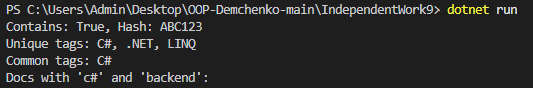

### Самостійна робота №9 (`IndependentWork9/README.md`)

# Самостійна робота №9: Дослідження `Dictionary<TKey, TValue>` та `HashSet<T>` у .NET

## Мета роботи
Вивчити внутрішню будову, часову складність операцій та практичні сценарії застосування хеш-колекцій `Dictionary<TKey, TValue>` і `HashSet<T>` у платформі .NET.

## Реалізація
1. **`FileMetadataCache`** — кеш метаданих файлів (`Dictionary<string, FileMetadata>`) із використанням `StringComparer.OrdinalIgnoreCase` для регістронезалежного доступу за $O(1)$.
2. **`TagManager`** — менеджер унікальних тегів статей (`Dictionary<string, HashSet<string>>`), що використовує операції теорії множин `UnionWith` (збір усіх унікальних тегів) та `IntersectWith` (пошук спільних тегів між статтями).
3. **`SearchIndex`** — базовий інвертований індекс (`Dictionary<string, HashSet<int>>`) для миттєвого пошуку документів за одним або кількома ключовими словами.

## Порівняння характеристик колекцій
| Операція | `Dictionary<TKey, TValue>` | `HashSet<T>` | `List<T>` |
| :--- | :---: | :---: | :---: |
| Пошук (`Contains` / `TryGetValue`) | $O(1)$ | $O(1)$ | $O(n)$ |
| Додавання (`Add`) | $O(1)$* | $O(1)$* | $O(1)$* |
| Видалення (`Remove`) | $O(1)$ | $O(1)$ | $O(n)$ |
| Унікальність елементів | Тільки ключі | Усі елементи | Відсутня |

*\*Амортизована складність.*

## Запуск проєкту

