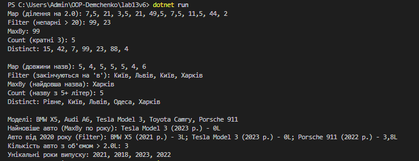

# Лабораторна робота №13: Generic-методи та делегати

**Дисципліна:** Об'єктно-орієнтоване програмування  
**Тема:** Generic-методи для повторного використання компонентів: Mapper/MaxBy/Reduce з Func/Action  
**Варіант:** 6  

---

### Реалізовані методи (`FunctionalUtils`)

У межах варіанту 6 реалізовано 5 generic-методів:
1. `Map<T, TResult>` — перетворення елементів колекції за допомогою `Func<T, TResult>`.
2. `Filter<T>` — фільтрація елементів за умовою `Func<T, bool>`.
3. `MaxBy<T, TKey>` — пошук елемента з максимальним значенням ключа (`where TKey : IComparable<TKey>`).
4. `Count<T>` — підрахунок кількості елементів, що задовольняють умові `Func<T, bool>`.
5. `Distinct<T>` — вибір унікальних елементів колекції.

---

### Контрольні запитання

1. **Що таке generic методи і які переваги вони дають?**
   Generic (узагальнені) методи дозволяють створювати логіку, яка працює з будь-якими типами даних. Основні переваги: повторне використання коду, типобезпека на етапі компіляції та вища продуктивність за рахунок відсутності boxing/unboxing для значущих типів.

2. **Яка різниця між делегатами `Func<T>` та `Action<T>`?**
   `Func<T, TResult>` використовується для функцій, які приймають аргументи та повертають значення. `Action<T>` використовується для методів, які виконують певну дію і нічого не повертають (`void`).

3. **Що таке функції вищого порядку? Наведіть приклади.**
   Це функції, які приймають інші функції як параметри або повертають їх як результат. Приклади: `Map`, `Filter`, `MaxBy`, `Count`, `Distinct`.

4. **Навіщо потрібні обмеження (constraints) для generic типів?**
   Обмеження (наприклад, `where TKey : IComparable<TKey>`) вказують компілятору, що тип повинен реалізовувати певні інтерфейси чи мати певні властивості. Це дозволяє безпечно викликати їхні методи (наприклад, `CompareTo`) усередині generic-методу.

5. **Як лямбда-вирази спрощують роботу з делегатами?**
   Лямбда-вирази дозволяють лаконічно записувати анонімні функції безпосередньо в місці їх виклику (наприклад, `x => x % 2 == 0`), уникаючи створення окремих пойменованих методів.

