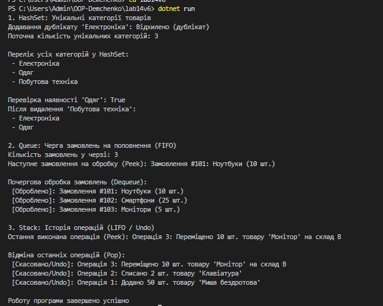

# Лабораторна робота №14 — Варіант 6

**Тема:** Спеціалізовані колекції `HashSet<T>`, `Queue<T>`, `Stack<T>`  
**Предмет:** Об'єктно-орієнтоване програмування  
**Проєкт:** `lab14v6`

---

## Опис проєкту

Програма моделює **Систему управління інвентарем**, демонструючи використання трьох базових типів колекцій в .NET відповідно до вимог варіанту 6:

1. **`HashSet<T>` — Унікальні категорії товарів:**
   * Забезпечує збереження лише унікальних назв категорій товарів.
   * Демонструє відхилення дублікатів при додаванні (`Add()`), перевірку наявності елемента за $O(1)$ (`Contains()`) та видалення категорій (`Remove()`).

2. **`Queue<T>` — Черга замовлень на поповнення:**
   * Реалізує дисципліну **FIFO** (First In, First Out).
   * Додає замовлення в кінець черги (`Enqueue()`), переглядає наступне замовлення (`Peek()`) та обробляє їх у порядку надходження (`Dequeue()`).

3. **`Stack<T>` — Історія операцій (Undo):**
   * Реалізує дисципліну **LIFO** (Last In, First Out).
   * Записує дії з товарами на вершину стеку (`Push()`), переглядає останній запис (`Peek()`) та виконує відміну дій у зворотному порядку (`Pop()`).

---

## Відповіді на контрольні запитання

1. **У чому різниця між `List<T>` та `HashSet<T>`?**
   `List<T>` — це впорядкована колекція з можливістю зберігання дублікатів та доступом за індексом, де пошук елемента виконується за $O(n)$. `HashSet<T>` — неупорядкована колекція унікальних елементів, де операції пошуку, додавання та видалення виконуються в середньому за $O(1)$.

2. **Коли доцільно використовувати `Queue<T>` замість `List<T>`?**
   `Queue<T>` використовують, коли потрібна сувора обробка за принципом першим прийшов — першим пішов (FIFO). Видалення з початку черги `Queue<T>` виконується за $O(1)$, тоді як у `List<T>` це потребує зсуву всього масиву і займає $O(n)$.

3. **Наведіть приклад реальної задачі, де потрібен `Stack<T>`.**
   Функціонал скасування дій (Undo/Redo) в редакторах, кнопка повернення назад у браузері (історія навігації) або алгоритми обходу структур/дерев у глибину (DFS).

4. **Яка складність операції `Contains()` для `HashSet<T>` і чому?**
   Складність становить $O(1)$ у середньому, оскільки `HashSet<T>` побудований на основі хеш-таблиці. Хеш-код елемента обчислюється миттєво, що дозволяє одразу звернутися до відповідної комірки в пам'яті.

5. **Чому `Queue<T>` називають FIFO, а `Stack<T>` — LIFO?**
   `Queue<T>` є **FIFO** (First In, First Out), бо перший доданий елемент обробляється першим. `Stack<T>` є **LIFO** (Last In, First Out), оскільки останній доданий елемент дістається першим.

---

## Результат роботи програми

