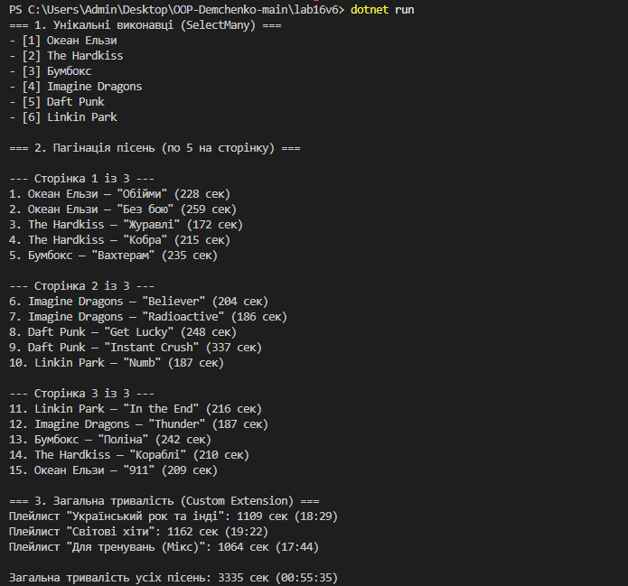

# Лабораторна робота №16
**Тема:** LINQ: `SelectMany`, пагінація й custom extensions  
**Виконав:** Демченко В. В.  
**Варіант:** 6  

---

## 1. Мета роботи
Опанувати практичні навички роботи з розширеними можливостями LINQ у мові C#, зокрема:
* вирівнювання вкладених колекцій за допомогою `SelectMany` та фільтрацію унікальних об'єктів через `DistinctBy`;
* реалізацію посторінкового виведення даних (пагінації) за допомогою методів `Skip` та `Take`;
* створення та використання власних методів розширення (custom extension methods) для обробки колекцій.

---

## 2. Хід виконання роботи

1. **Створення структури проєкту та моделей даних**  
   У консольному застосунку .NET (`lab16v6`) реалізовано предметну область музичного сервісу, що складається з трьох пов'язаних класів:
   * `Artist` — зберігає ідентифікатор (`Id`) та ім'я виконавця (`Name`).
   * `Song` — описує окремий трек: ідентифікатор (`Id`), назву (`Title`), тривалість у секундах (`DurationSeconds`) та посилання на виконавця (`Artist`).
   * `Playlist` — представляє плейлист із назвою (`Name`) та списком пісень (`List<Song>`).

2. **Реалізація методу розширення (Custom Extension)**  
   Створено статичний клас `SongExtensions` із методом розширення `TotalDuration(this IEnumerable<Song> songs)`, який обчислює сумарну тривалість усіх композицій у переданій колекції за допомогою методу агрегації `Sum()`.

3. **Формування тестових даних та виконання LINQ-запитів**  
   У методі `Main` ініціалізовано 6 виконавців та 3 плейлисти (загалом 15 пісень) і виконано три завдання варіанту:
   * **Унікальні виконавці:** використано `SelectMany(p => p.Songs)` для об'єднання пісень з усіх плейлистів в єдиний потік, `Select(s => s.Artist)` для вибірки виконавців та `DistinctBy(a => a.Id)` для усунення дублікатів.
   * **Пагінація списку пісень:** загальний список композицій розбито на сторінки по 5 елементів. Кількість сторінок визначено через `Math.Ceiling(allSongs.Count / (double)pageSize)`, а вибірку кожної сторінки реалізовано через `.Skip((page - 1) * pageSize).Take(pageSize)`.
   * **Підрахунок тривалості:** застосовано власний метод `.TotalDuration()` для кожного плейлиста окремо та для всіх пісень загалом із форматуванням часу через `TimeSpan.FromSeconds()`.

---

## 3. Відповіді на контрольні запитання

1. **У чому полягає різниця між методами `Select` та `SelectMany` у LINQ?**  
   * `Select` виконує проєкцію кожного елемента колекції 1-до-1 і повертає колекцію тієї ж розмірності (наприклад, при зверненні до списку плейлистів ми отримаємо колекцію списків пісень `IEnumerable<List<Song>>`).
   * `SelectMany` виконує проєкцію та «вирівнює» (flatten) вкладені колекції в одну плоску послідовність (наприклад, об'єднує пісні з усіх плейлистів в єдиний список `IEnumerable<Song>`).

2. **Як реалізується пагінація (посторінкове виведення) у LINQ і яка стандартна формула використовується?**  
   Пагінація реалізується комбінацією методів `Skip` (пропускає задану кількість елементів від початку) та `Take` (бере вказану кількість наступних елементів). Для отримання сторінки з номером `page` (нумерація з 1) та розміром `pageSize` використовується формула:  
   `collection.Skip((page - 1) * pageSize).Take(pageSize)`.

3. **Які обов'язкові вимоги висуваються до створення власних методів розширення (Extension Methods) у C#?**  
   * Метод має бути оголошений усередині статичного (`static`), не узагальненого класу верхнього рівня.
   * Сам метод також повинен мати модифікатор `static`.
   * Перший параметр методу визначає тип, який розширюється, і обов'язково позначається ключовим словом `this` (наприклад, `this IEnumerable<Song> songs`).

4. **У чому різниця між `Distinct()` та `DistinctBy()`?**  
   * `Distinct()` порівнює об'єкти цілком (для посилальних типів за замовчуванням порівнюються посилання в пам'яті, якщо не перевизначено `Equals`/`GetHashCode`).
   * `DistinctBy()` дозволяє вказати конкретний ключ (властивість), за яким визначається унікальність елемента (наприклад, `DistinctBy(a => a.Id)`), що зручно при роботі зі складними моделями даних.

5. **Що таке відкладене виконання (Deferred Execution) у LINQ та які методи викликають негайне виконання?**  
   Більшість LINQ-методів (`Where`, `Select`, `SelectMany`, `Skip`, `Take`) не виконуються в момент оголошення запиту — вони лише формують план запиту, який спрацьовує під час перебору результатів (у циклі `foreach`). Негайне виконання (Immediate Execution) запускають методи матеріалізації колекції (`ToList()`, `ToArray()`, `ToDictionary()`) або агрегації (`Count()`, `Sum()`, `First()`).

---

## 4. Висновки
Під час виконання лабораторної роботи було закріплено навички роботи з технологією LINQ у C#. Використання методу `SelectMany` дозволило ефективно об'єднати вкладені списки пісень із різних плейлистів в єдину послідовність, а `DistinctBy` — отримати перелік унікальних виконавців. Комбінація методів `Skip` та `Take` забезпечила коректну пагінацію списку композицій, а створення власного методу розширення `TotalDuration` для `IEnumerable<Song>` зробило обчислення сумарної тривалості компактним та зручним для повторного використання.

---

## 5. Результат роботи програми

