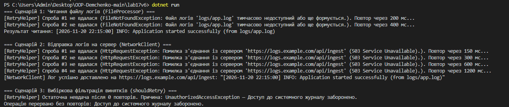

# Лабораторна робота №17 (Варіант 6): Обробка помилок вводу/виводу та мережевих збоїв. Патерн Retry

## Мета роботи
Навчитися обробляти винятки вводу/виводу (`FileNotFoundException`) та мережеві помилки (`HttpRequestException`), а також реалізувати узагальнений механізм повторних спроб (`RetryHelper`) з експоненційною затримкою для підвищення відмовостійкості застосунків.

## Реалізація (Сценарій: Відправка логів)
* **`RetryHelper`** — статичний узагальнений клас із методом `ExecuteWithRetry<T>`, який виконує операцію, обчислює експоненційну затримку між спробами за формулою $t = t_0 \cdot 2^{\text{attempt}}$, логує кожну спробу та перевіряє доцільність повтору через делегат `shouldRetry`.
* **`FileProcessor`** — імітує тимчасову відсутність файлу (`FileNotFoundException` на перших 2 викликах) при виконанні `GetLogContent(path)` із подальшим успішним читанням.
* **`NetworkClient`** — імітує мережеву недоступність сервера (`HttpRequestException` на перших 4 викликах) у методі `SendLogToServer(url, logContent)` із подальшою успішною доставкою.

## Запуск проєкту

