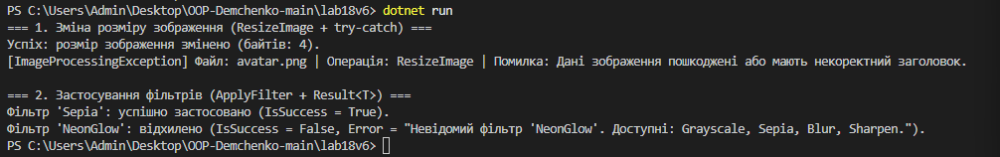

# Лабораторна робота №18 (Варіант 6): Власні винятки та патерн Result

## Мета роботи
Навчитися створювати спеціалізовані класи винятків на основі `System.Exception` та застосовувати патерн `Result<T>` для контрольованої обробки очікуваних помилок без витрат на генерацію винятків.

## Реалізація (Сценарій: Обробка зображень)
* **`ImageProcessingException`** — власний клас винятку, що містить контекстні властивості `ImageName` (назва файлу) та `Operation` (назва операції обробки).
* **`Result<T>`** — узагальнений контейнер результату виконання операції з властивостями `IsSuccess`, `Value`, `Error` та статичними фабричними методами `Success(T)`, `Failure(string)` і `Failure(Exception)`.
* **`ImageProcessor`**:
  * `ResizeImage(byte[] imageData, int width, int height)` — викидає `ImageProcessingException` при виявленні пошкодженого буфера зображення або некоректних габаритів;
  * `ApplyFilter(byte[] imageData, string filterName)` — повертає `Result<bool>` із описом причини у полі `Error`, якщо користувач передав непідтримуваний фільтр.

## Запуск проєкту  

